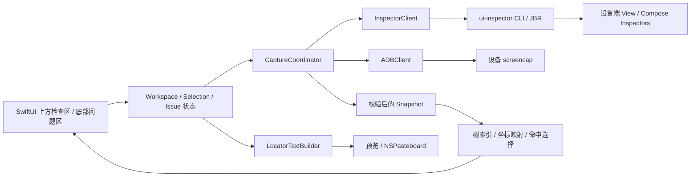

> 产品约定更新（2026-11-01）：应用仅服务当前实时抓取，不再提供导入、示例或历史恢复；新抓取成功、切换目标会清空旧问题。布局和工具偏好仍持久化。下文早期的会话归档/导入目标已由此约定取代，当前行为见 macOS/README.md。

# CompScope macOS 应用技术方案

日期：2026-10-31。状态：工程与界面首轮实现中；架构目标基于当前工作区源码和已确定的[静态线框图](ui-design/compose-inspect-wireframe.html)。已落地范围与启动方式见 [macOS 工程说明](../macOS/README.md)，实时设备与完整 JSON 接入已落地，具体实现和边界见 [JSON 接入说明](ui-inspector-json.md)。

## 1. 目标与首版范围

CompScope 是面向 Android Jetpack Compose 开发的 macOS UI 检查应用。核心流程是：连接设备和目标应用 → 获取截图与组件树 → 选中组件并按需勾选参数 → 直接输入描述 → 非空内容自动记录为该组件的问题 → 复制当前问题或全部问题的精简 AI 定位文本。一个界面可记录多个组件的问题；同一组件在当前快照中对应一条问题，多个修改写在同一段描述中。

首版提供单设备、单目标应用、默认显示屏的手动快照检查。保留多个应用窗口的树，但重叠窗口需用户明确选择，不自动推断前后顺序。不实现设备远程操作、实时视频、重组监控、自动修复代码或 AI 服务调用。生成复制文本采用本地确定性规则，无需模型或 API Key。

产品验收重点：选中目标准确、图片与树对应、文本足够定位且尽量短。节点详情可以丰富，复制内容按需收敛。

## 2. 当前基础与已核实边界

### 2.1 工作区现状

- 已有独立的 `ui-inspector/` 子项目、构建脚本、deploy JAR、项目内 JBR 25 与 ADB；详见[本地构建说明](../ui-inspector/README.md)。
- 当前启动入口为 `ui-inspector/bin/ui-inspector`，CLI 报告版本 `1.0`。已验证 `--version`、`dump-ui --help` 及模拟器上的真实抓取。当前 JAR 实际需要 Java 25+。
- 已建立 `macOS/` 原生 SwiftUI + AppKit 应用工程及本地 Swift Package 核心库，支持示例/导入快照、界面选择联动、多问题和复制。现已接入真实 ADB、JAR 执行、双轮采集、无损 JSON 文档和参数续读。本文更细的像素比较、源码校准、正式分发等仍为方案目标；实现差异以 [JSON 接入说明](ui-inspector-json.md) 为准。
- 以本地 CLI 和 JSON 序列化源码为接入契约。上游 main 会变化，不能仅凭 CLI 的 `1.0` 判断 schema 相同；接入时记录源码版本标识或归档校验值、JAR SHA-256 和 schema fixture。

### 2.2 能力与限制

| 项目 | 本地实现与方案影响 |
| --- | --- |
| 组件抓取 | `dump-ui` 返回 View / Compose 合并树，macOS 端不再重建两套树的挂接关系 |
| 参数 | `--include attributes` 包括 Compose 参数；修饰符从参数结构中提取，不假定存在顶层 `modifiers` 字段 |
| 语义 | `--include semantics` 获取 merged / unmerged semantics，用于提取文字、描述、testTag 等可用定位信息 |
| JSON 根结构 | 当前是 `windows[]` 和 `displays[]`，不是上游 README 早期示例中的 `roots[]` |
| 源码位置 | Compose 节点可有 `sourceLocation.fileName`、`lineNumber`；注意 JSON 键为 `fileName`，不是 `filename`。位置可缺失，通常不足以直接确定本地完整路径 |
| 坐标 | `bounds` 定义为屏幕坐标中的轴对齐包围矩形；视觉变换可能扩大矩形，不能当作精确轮廓或可见区域 |
| 系统节点 | 默认剥离系统 composable，可通过 `system-composables` 包含；内部模型有 `isSystemCreated`，当前 JSON 没有输出该字段，客户端不能假定可读取 |
| 详细参数 | 截断值带 `isTruncated` 和不透明 `continuationToken`；通过 `get-parameter` 显式展开 |
| 截图 | 当前 CLI 没有截图命令，需要独立使用 ADB |
| 设备条件 | 本地常量最低 API 为 29；目标应用需已安装、可调试、在当前 Android 用户下运行，检查时保持前台可见 |
| 同步性 | View、Compose 和截图并非一个原子抓取；即使同一次 `dump-ui` 也不能承诺全部节点属于同一帧 |

证据入口见文末本地源码索引。上游能力背景参考 [UI Inspector README](https://android.googlesource.com/platform/tools/base/+/mirror-goog-studio-main/ui-inspector/)。

## 3. macOS 技术选择与分层

首版建议采用 **Swift + SwiftUI + 少量 AppKit，最低 macOS 14，优先 Apple Silicon**。最低系统版本是产品选型；Intel 支持需要另行补齐并验证 JBR、ADB 及其他本机运行依赖，不能由 Swift universal binary 单独保证。

| 层 | 选择与职责 |
| --- | --- |
| 窗口与界面 | 外层 `VSplitView` 组织上方检查区和底部问题工作区；上方 `HSplitView` 分组件树、图片画布、右侧组件参数选择栏；底部 `HSplitView` 左侧问题列表、右侧当前问题输入与预览；顶部紧凑单行工具栏只放设备、应用与获取界面入口，不放应用名或示例说明，设计目标约 44pt；选择、线框开关、适合窗口三个控件悬浮于预览区右下角，保留原生窗口与可调整分栏 |
| 画布 | 截图用 `CGImage` 保存像素尺寸，SwiftUI Image 显示；Canvas 绘制普通线框、选中框与标签；手势统一转换到画布坐标 |
| 状态 | `@MainActor` 管理界面状态；独立 capture actor 串行执行抓取，解析与文件读写不占用主线程 |
| 进程 | Foundation `Process` 调用 CLI 与 ADB；运行参数以数组传入，stdout / stderr 独立收集 |
| 解码 | 自定义 `InspectorJSON` 保留任意对象、数组、标量及数字原文；`InspectorDocument` 归档原始字节，再派生领域模型 |
| 复制 | AppKit `NSPasteboard.general` 写入 `.string`，预览内容与剪贴板内容完全一致 |
| 存储 | `UserDefaults` 保存栏宽、显示线框等偏好；会话临时文件放应用缓存，不引入数据库 |

参考 Apple 的 [Process](https://developer.apple.com/documentation/foundation/process)、[Canvas](https://developer.apple.com/documentation/swiftui/canvas) 和 [NSPasteboard](https://developer.apple.com/documentation/appkit/nspasteboard) 文档。上述分层为本项目设计选择。



先通过 CLI 隔离 JVM 与 Swift。不在首版内嵌 JVM、移植注入协议或直接维护 protobuf 连接。CLI 已负责部署设备端 agent、匹配 Compose inspector、树合并和连接清理；macOS 端负责用户工作流。之后只有在真机测量确认 CLI 启动或全树抓取成为瓶颈时，再考虑基于 Kotlin core 增加常驻 bridge。

## 4. ui-inspector 与 ADB 接入

### 4.1 路径与启动约定

**设置约定更新（已实现）**：macOS App 提供 `⌘,` 原生设置窗口；Java、ADB 默认从应用进程环境变量解析，手动配置优先。Java 顺序为 JAVA_HOME → JDK_HOME → PATH；ADB 顺序为 ADB → ADB_PATH → ANDROID_HOME → ANDROID_SDK_ROOT → PATH。路径留空表示自动，设置自动保存，显示实际路径、来源与版本检测结果。Finder 启动可能无法读取终端环境，允许手动选择；不通过执行 shell 配置文件获取变量。具体行为见 [工具环境设置](../macOS/README.md#工具环境设置)。

下述项目内路径属于独立 CLI 的开发调试入口，不能作为 macOS App 当前设置的隐式默认值。实时抓取已显式使用设置解析出的 java / adb，不直接调用会覆盖这些环境的现有 shell launcher；未来若交付内置运行时，需要另加明确的选择策略。

开发阶段使用现有启动脚本和项目内 ADB：

```text
CLI: <workspace>/ui-inspector/bin/ui-inspector
ADB: <workspace>/ui-inspector/vendor/android/prebuilts/studio/sdk/darwin/platform-tools/adb
```

路径由 `ToolchainResolver` 提供，不写死开发者目录。应用使用绝对 executable URL；CLI 和截图使用同一套 ADB，并保持一致的 ADB server 配置。Finder 启动没有终端 PATH 时仍须可用。不存在或无法执行时显示“工具链未就绪”，不在 UI 抓取过程中自动触发 Bazel 构建。

现有脚本在 JAR 缺失时会调用构建，因此 App 需要先检查 JAR 与 JBR。发布版单独提供只运行、不构建的启动方式，随 App 或工具包交付已验证的 JAR、最小 Java runtime、ADB 及所需资源；不复制整个 vendor/Bazel/SDK 工作区。分发与签名细节在完成首轮连接验证后确定，首版按直接分发的开发工具规划，外部进程与资源访问需做实际打包验证。

### 4.2 设备和应用选择

1. `adb devices -l` 枚举设备，区分 online、offline 和 unauthorized；只有 online 可抓取。
2. 允许输入目标包名，并从安装包列表提供候选；已安装不代表可调试或正在运行，具体能力由连接预检与 CLI 错误反馈确认。
3. 每次抓取显式传 `--device` 和 `--package`，不依赖默认前台应用，以免用户切屏后检查错误对象。
4. 切换设备、包名或目标进程重启时，使当前选择与 continuation token 失效。

### 4.3 命令契约

以下命令为项目根目录下的手动调试示例。App 内使用 `Process.arguments`，截图重定向由文件句柄实现，不拼接 shell 字符串。

```sh
./ui-inspector/bin/ui-inspector dump-ui \
  --device <serial> --package <package> \
  --include attributes,semantics \
  --output <capture-directory>/tree.json
```

首次默认请求 `attributes,semantics`，让选中后的详情与定位文字来自同一份树，而不是点中节点后再执行另一份全树抓取。暂不请求 `all` 或 `resolution-stack`：后者会设置持久设备选项，并可能重启 Activity，破坏当前界面。

```sh
<adb-path> -s <serial> exec-out screencap -p > <capture-directory>/screen.png
```

ADB 官方给出的截图方式见 [screencap 文档](https://developer.android.com/tools/adb#screencap)。PNG 作为二进制流读取，不能经字符串解码再保存。

需要展开截断参数时：

```sh
./ui-inspector/bin/ui-inspector get-parameter \
  --device <serial> --package <package> \
  --continuation-token <opaque-token> \
  --output <capture-directory>/parameter.json
```

只在用户展开对应参数时执行，不递归追踪所有 token。该命令会重新读取当前 UI，结果属于“后续读取”，不能视为旧快照不可变数据。刷新、切换目标或检测到页面变化后清空 token；上游同名同摘要的值也可能已变更，所以 token 可用不等于内容未变。

### 4.4 进程管理

- 抓取进程按设备串行，不并行启动多份注入；每个请求携带 generation ID，旧请求迟到的结果不得覆盖新状态。
- stdout / stderr 持续排空，或直接写入会话文件，防止管道写满。退出码成功、输出可读且 JSON / PNG 校验通过才进入发布流程。
- CLI 日志走 stderr；保留诊断，不将 stderr 混进 JSON。错误分为目标不可用、注入失败、依赖解析失败、进程超时、schema 不兼容及截图失败。
- 配置可取消的 App 总超时；初始建议常规抓取 120 秒、首次依赖解析 180 秒，属于待真机校准值。CLI 单次命令响应自身有 90 秒上限，总耗时可能包含多个响应。
- 正常结束让 CLI 清理自身 adb forward；取消先请求进程退出、宽限后再强制结束。强杀可能跳过清理，后续仅处理确认由本会话创建的资源，不使用 `adb forward --remove-all` 或 `adb kill-server`。
- Compose inspector 无法下载时显示原因，并提供本地 `--compose-inspector` JAR 的配置入口。

## 5. 快照数据模型与契约适配

### 5.1 本地 JSON 形状

以下为最小结构示例，不代表真机抓取结果；省略字段按缺失处理。

```json
{
  "displays": [{"id": 0, "widthPx": 1080, "heightPx": 2400, "orientation": 0}],
  "windows": [{
    "configuration": {"density": 480},
    "root": {
      "type": "ViewNode", "id": 1, "className": "ComposeView",
      "bounds": {"x": 0, "y": 72, "width": 1080, "height": 2256},
      "children": [{
        "type": "ComposeNode", "id": 42, "className": "Button",
        "bounds": {"x": 72, "y": 1032, "width": 936, "height": 144},
        "sourceLocation": {"fileName": "LoginScreen.kt", "lineNumber": 86},
        "parameters": [{"name": "enabled", "value": true}]
      }]
    }
  }]
}
```

`configuration`、`theme`、`sourceLocation`、参数与语义数组均可能缺失。`children` 缺失表示空列表。参数 `value` 可以是字符串、数值、布尔、null 或带单位等信息的对象，不能统一按 String 解码。对未知非关键字段容忍，对根结构、节点类型及关键坐标字段做明确校验，不能解码失败后静默显示空树。

### 5.2 内部模型

| 模型 | 关键字段与约束 |
| --- | --- |
| `CaptureTarget` | serial、packageName、可获取时的 PID、generation |
| `Snapshot` | UUID、target、各采集步骤起止时间、PNG、pixelSize、displays、windows、coordinateMapping、consistency、工具版本摘要 |
| `WindowSnapshot` | 当前快照内 windowKey、根节点、configuration、theme；display 归属缺失时不自行伪造 |
| `InspectorNode` | nodeKey、原始 Int64 ID、type、className、boundsPx、parentKey、childKeys、可选 source、参数与语义 |
| `SourceAnchor` | reportedFile、reportedLine、可选 normalizedLine / resolvedRelativePath、解析状态；保留原始值 |
| `SelectionState` | 当前浏览的 snapshotID、windowKey、nodeKey、候选节点；不保存问题描述，不自动改写已有问题的目标 |
| `IssueWorkspace` | 当前界面的有序 issues、按组件查找的问题索引、activeIssueID（可空）、目标应用与来源快照集合；只包含非空描述的问题 |
| `ComponentEditState` | 当前 componentKey、编辑文本、参数勾选、输入法组合状态；无描述时只是编辑状态，不是已记录问题 |
| `IssueDraft` | UUID、componentKey、boundTarget、selectedParameterRefs、非空 description、locatorOverride、validationState；由非空输入自动创建或更新，不设 title 字段 |
| `IssueTarget` | 绑定的 snapshotID、windowKey、nodeKey、源码/语义锚点、定位摘要；来源快照需保留，不依赖最新 SelectionState |
| `SelectedParameter` | 问题内参数引用、命名空间（parameters / modifier / mergedSemantics / unmergedSemantics / attributes）、嵌套路径、采集时值与截断状态；同名参数不混淆 |
| `PresentationState` | showWireframes、zoom、panOffset、expandedTreeKeys、上下分栏高度与底部左右栏宽 |

`nodeKey` 使用 `(snapshotID, windowKey, type, rawID, treePath)`，避免不同窗口、不同类型与重复 ID 冲突。rawID 不作为源码锚点，也不假定刷新后稳定。Swift 端保留 Int64，不经 JavaScript Number 中转。

快照建成后视为不可变。树索引和命中缓存由快照派生；参数后续读取另外存储并标注时间。刷新先完整构建下一份快照，再原子替换界面中的图片和树。已有问题仍引用各自绑定的来源快照，不替换目标或参数值。首版 componentKey 使用来源快照中的 nodeKey；刷新后的节点不凭 rawID 与旧问题自动合并，旧问题可从列表恢复到原快照。

## 6. 截图与组件树的一致性

CLI 抓取与 `screencap` 相互独立，首版只能获得经过检查的近时快照，不能承诺严格同帧。

推荐首版采集顺序：

1. 创建临时 capture 目录和 generation；记录设备、包名、可获取的 PID 与显示方向。
2. 先执行一次 `dump-ui`，完成首次注入与 Compose inspector 解析，得到候选树 T1。
3. 立即抓取图片 S1，再执行一次同参数 `dump-ui` 得到 T2，随后抓取图片 S2。
4. 比较 T1 / T2 的结构、bounds、源码锚点与关键可见文字；比较解码后的 S1 / S2 像素，排除明确的系统状态区域干扰。若目标进程或方向变更、布局不同、图片内容明显改变，标记不稳定。
5. 通过检查时发布 T2 + S2；不稳定时最多自动重试一轮，再提示“界面仍在变化，请停留后重新获取”。
6. 任一步失败都不将新图片与旧树拼接；保留上一次完整快照，并显示失败状态。

这种夹取与比较会增加抓取耗时，但可避开首次注入/下载导致的长时间差，适合首版“先选准”的目标。不能把比较通过描述为同帧证明：页面可能在步骤之间变化后恢复，View/Compose 也存在内部采集间隔。时间、像素差阈值应由真机样本校准，不用固定毫秒数宣称可靠。

动画页可保留“近时采集，可能错位”的可检查结果，但不能展示为已校验快照；用户仍可检查与复制时，需在 UI 标注来源状态。后续若需要连续画面与严格配对，应扩展采集协议，加入设备端统一采集序号、时间戳和窗口/显示标识；当前上游未提供这套协议。

## 7. 坐标关联与图片线框

### 7.1 坐标约定

内部统一使用 Android 屏幕像素坐标，原点左上、x 向右、y 向下。macOS 画布使用本地逻辑点坐标，坐标映射只发生在绘制和命中边界。

- 默认保留整屏截图，包括系统栏；不先裁出应用内容。`bounds` 已表达屏幕位置，不能再次统一减去状态栏高度或累加每层父节点偏移。
- 本地 Compose 转换代码对变换后的 render quad 计算包围框，并应用窗口偏移；普通 layout bounds 与多窗口偏移须用 fixture 和真机标记点验证，不在 Swift 层凭经验额外补偿。
- `displays.widthPx/heightPx` 来源于物理显示模式，不一定等于截图当前方向/分辨率。显示模式、旋转、逻辑分辨率覆盖均需检查，不能仅依靠 orientation 盲目交换宽高。
- 首版限定默认显示屏。当前 JSON 的 window 没有明确 displayId 或可靠 z-order；检测到外接屏或窗口归属不明时，不自动把所有根叠到同一图片。允许看树，要求明确限制或补充上游元数据后再支持关联。
- 只有明确是同一显示区域且验证过的缩放关系才允许缩放修正；尺寸来源无法解释时关闭点选/线框并显示坐标不匹配，不能分别拉伸 x/y 来强行对齐。
- Android density 只用于 px ↔ dp 的数值展示：`dp = px × 160 / densityDpi`。macOS Retina backing scale 不参与 Android 坐标计算。节点 render bounds 的换算高度不能直接断言为源码 `Modifier.height` 值。

### 7.2 图片到画布的映射

设 PNG 像素尺寸为 `Iw × Ih`，可用画布为 `Cw × Ch`，用户缩放为 `z`，平移为 `pan`：

```text
s = min(Cw / Iw, Ch / Ih) × z
offset = ((Cw - Iw × s) / 2, (Ch - Ih × s) / 2) + pan

canvasPoint = offset + imagePixelPoint × s
imagePixelPoint = (canvasPoint - offset) / s
```

当截图和 Android 屏幕像素一一对应时，`imagePixelPoint = androidScreenPoint`。如存在经过校准的区域映射，另用显式的 `screenToImage` 仿射变换，并在命中时使用逆变换。图片、边框、标签和手势必须复用同一个 `CoordinateMapper`，不能各自算缩放。

点击图片外的留白不命中任何节点。若使用默认非 flipped 的 AppKit NSView 承载画布，先将其事件 y 轴转换为左上原点，再进入同一 mapper。

### 7.3 边框渲染

“显示线框”开关位于截图预览区右下角悬浮工具组，紧凑标签为“线框”，与选择组件、适合窗口控件并列。使用画布容器上的 bottomTrailing overlay，位于节点路径上方，保留约 14pt 的边缘间距；工具组不应用图片的缩放/平移变换，点击控件由工具层消费，不向下触发组件命中。窄宽度允许紧凑排列或换行，不能溢出预览容器或被侧栏遮挡。

线框默认开启并记住偏好。开启时绘制当前窗口、可用区域内的组件边界；关闭时隐藏普通边界，保留选中框和节点标签。两种状态均可点选，不重新抓取，不改变树或复制内容。

普通节点细虚线，选中节点高对比实线；标签尽量放在图片内并避开目标，线宽按 macOS 点数保持稳定，不随图片放大而成倍增粗。同矩形普通边框可合并绘制以降低杂乱，但候选索引保留全部节点。

矩形只按截图/画布区域裁剪；不能无条件与所有祖先 bounds 求交，因为子节点可能越过不裁剪的父布局。没有上游 clip/visibility 元数据时，只能做保守命中。零尺寸或完全在图外的节点留在树中，但不参与画布选取。

## 8. 点选、组件树与检查面板联动

组件树采用 AppKit `NSOutlineView`，通过 `NSViewRepresentable` 与 SwiftUI 状态连接。原生 selection delegate 在第一次单击时更新选中组件，doubleAction 只切换当前行的展开/收起，不使用等待双击判定后才触发单击的互斥手势。展开箭头保持独立操作；程序化同步展开与选择时抑制 delegate 回调，避免重复提交或折叠后又被状态同步强制展开。原生树提供键盘导航，外部问题/截图选择仍通过统一入口展开祖先并滚动定位。搜索结果首次展开，允许用户在搜索期间手动折叠。

1. 点击画面后经逆变换得到屏幕坐标，在当前窗口中检索所有包含该点的有效节点。
2. 初始按更深层级、更小面积排序，生成完整候选集合。此排序只是选择策略，不表示真实绘制 z-order。
3. Text 是 Button 子节点时提供父链切换，不静默把“选中文本”改成“选中按钮”。可在候选中提升明确具有交互语义的父节点，但保留用户最终选择。
4. 同尺寸嵌套、重复列表项、Dialog / Popup、变换后的包围框重叠都允许候选切换；跨窗口先选择窗口。没有充分数据时不声称能自动识别最上层可见组件。
5. 选择节点前提交原组件已完成输入的非空描述，再更新唯一的 `SelectionState`：截图高亮、树展开滚动、右侧参数和底部输入同步切换到新组件。新组件有问题则恢复其描述，没有则显示空输入；原问题仍属于原组件，不随选择迁移。树点击与问题列表点击走同一选中入口，后者先解析其绑定目标。
6. 刷新后默认清除浏览选择；仅在源码锚点、语义与路径能唯一匹配时恢复，不能靠旧 ID 恢复到任意同号节点。问题列表保留，旧来源问题显示快照标记；选择它时展示绑定的旧快照，不能用新图高亮旧节点。

索引首版采用预先 flatten 的数组、父子映射和 bounding-box 扫描。测量显示有性能问题后再引入空间索引；画布边框批量绘制，不为每个节点创建单独 SwiftUI 可点击 View。

### 8.1 右侧组件参数选择栏

整体窗口按紧凑的一屏工作区规划：常规桌面宽度下设计目标约 760–800pt 总高度，底部问题区约占四分之一。上方预览按实际可用高度等比适配，不用固定大截图和多余留白撑开窗口；右侧属性使用紧凑行距，语义等次要分组默认折叠。App 中树、参数、问题列表与长文本各自滚动，`VSplitView` 可调整上下比例；必须限制面板的最小高度和内容优先级，避免随着节点或问题数量增加而拉长整个窗口。静态线框的窄宽度自然重排不等同于桌面 App 的高度约束。

右侧常驻展示当前浏览组件的源码位置、布局和参数选择窗口，按修饰符、组件参数与语义分组，每行有名称、值和勾选框。嵌套对象可展开并选叶子项；默认不勾选普通参数，避免全量导出。源码位置、组件名称和必要消歧信息是定位基础，不与普通参数开关混为一组。

参数勾选作用域为 `(componentKey, parameterPath)`，始终作用于当前选中组件，不需要先添加问题。未输入描述时可在会话内暂存勾选，但不创建问题、不增加列表计数；首次输入非空描述时，将当前勾选一并写入该组件的问题。已有问题的参数勾选即时更新该条记录；切换组件恢复各自的参数集合，不互相带入。

相同名称的参数用分组和完整路径区分。选择 modifier 的一个字段不隐含选择全部 modifier；选择对象应明确显示导出范围和截断状态，不递归拉取其所有 continuation token。未获取到的值不能被当作完整值输出；用户显式展开后取得的值需保留读取时间和来源标记。

### 8.2 底部多问题工作区

当前问题的 AI 文本预览使用可收起的右侧面板，编辑区工具栏提供“AI 预览”显隐开关；偏好通过 `showAITextPreview` 保存。收起后输入区占满可用宽度，不销毁或清空当前组件编辑状态，也不停止精简文本生成与复制。展开时使用独立横向分隔线调整输入与预览宽度，操作方式与 IDE 工具窗口一致。

底部为可调整高度的工作区：左侧有序问题列表，右侧为当前选中组件的描述输入与 AI 文本预览。问题列表只显示已有非空描述的组件，展示序号、组件摘要、描述首行预览和已选参数数量；右侧提供“复制当前问题”“复制全部问题”。不提供“新增问题”“保存问题”或“更换组件”步骤，组件选择本身决定输入归属。

不设计问题标题输入、命名步骤或 title 持久化字段，用户只填写问题描述。列表预览直接取 description 的首个非空行并在视图中截断，不改写或另存为标题；没有描述的组件不显示在列表中。内部使用 UUID 标识问题，列表序号仅作展示。无需调用模型生成标题；下游 AI 从组件定位、所选参数和描述识别问题。所有复制与校验均不要求标题，原始完整描述不受列表预览截断影响。

- **选中组件**：直接进入该组件的输入状态；无组件时输入区禁用并提示“先选择组件”。仅选择组件或参数不产生问题。
- **输入即记录**：以已提交输入去除首尾空白后的结果判断是否为空。首次非空时创建记录并追加到列表；之后更新同一 componentKey 的记录，保留 UUID 和顺序，不因每次输入新增条目。用户描述原文完整保留。
- **空内容不记录**：空白编辑状态不落为问题。已有问题的描述被清空后，从列表与持久化问题集合中移除；保持当前组件选中和空输入状态，可撤销恢复。没有描述时复制当前问题禁用。
- **切换组件**：先提交原组件输入，再加载新组件的已有问题或空状态；每个输入事件携带 componentKey，防抖写盘只写对应组件，不能因异步回调将旧描述写入新组件。
- **点击问题列表**：将该项来源快照与 nodeKey 交给统一选择入口，恢复对应控件高亮、树展开与滚动、右侧勾选、底部描述和预览。对组件 A 的问题点击必须选中 A，而非仅切换文本。无法恢复目标时显示原因，不选择同号的其他控件。
- **输入法与保存**：中文输入法的未提交组合文本不用于创建/删除问题，待提交后再判断。内存列表即时更新，持久化可防抖；切换组件、复制和关闭窗口前提交已完成输入，避免依赖失焦后才记录。
- **刷新与页面切换**：保留原问题及其快照引用。新抓取是否属于同一业务页面不能只凭包名自动确定；默认不搬移旧问题，页面不同时新建问题工作区。返回旧问题恢复来源快照；重启目标应用不使旧问题文本丢失，但旧 continuation token 不可复用。

记录约束为“同一来源快照的一个组件对应一条非空问题”。再次选中同一组件继续编辑已有内容，不重复创建。该组件的多个修改可写成多行描述；涉及其他组件时选中相应组件分别输入。问题列表的首次记录顺序保持稳定，编辑内容不自动重排。

## 9. 精简 AI 定位文本

### 9.1 文本契约

`LocatorTextBuilder` 是无网络的纯函数，输入为 `IssueDraft`、其绑定的快照/节点、源码锚点、明确勾选的参数值和用户修改描述，不直接读取当前浏览节点。输出只包含：

```text
<最短且足以消歧的定位信息>
<目标组件与必要文字/标签>
<勾选参数的精简值；未勾选则省略此行>
<用户修改描述>
```

不附加“请扮演开发专家”等模板，不附图片、Base64、全树、完整参数 JSON、设备序列号、时间戳或快照 ID。运行时 `#42` 对 AI 的源码检索没有稳定意义，默认不导出。

### 9.2 定位优先级与消歧

| 可用证据 | 默认策略 |
| --- | --- |
| 已解析的项目相对路径 + 有效行号 | 输出相对路径与行号，加组件名；有必要时补短文字或 testTag |
| 只有文件名 + 行号 | 保留报告的文件名和行号；同名文件可能冲突时补最近业务祖先或让用户选择源码文件 |
| 选中节点没有源码，祖先有源码 | 明确写“位于 `<祖先位置>` 内”，再补目标组件/短路径，不能把祖先行号冒充目标定义位置 |
| 无源码，但有 testTag / resourceId | 用业务屏幕/祖先路径 + 组件名 + tag/id |
| 文字重复或同一调用点多实例 | 补最短可区分的列表项文字、业务父节点或其他稳定语义；序号仅作当前快照辅助信息，不冒充稳定列表 key |
| 仍无法消歧 | 提供可编辑的屏幕名/组件定位补充字段；预览明确标记“定位不唯一”，不能用像素坐标伪装成源码定位 |

第一行可短，但“省 token”不能以丢失必要消歧信息为代价。针对同一源码行的多个实例，需要额外的实例语义，不能仅比较源码路径是否唯一。

### 9.3 源码位置可信度

`sourceLocation` 没有完整项目路径和版本校验。首版无需用户选择源码工程也可工作；若用户授权选择 Android 工程目录，可建立 `.kt` 文件名索引，排除 build、缓存与依赖产物，只在唯一命中时补项目相对路径。多候选时让用户选择，不猜目录。

先用已知行的最小 Compose 样例校准上游 `lineNumber` 的起算与调用点含义；转换规则只放在 adapter 并由 fixture 固定。原始值保留；未确认、无效或落在未知代码版本上的行号不作为已验证精准定位。源码改动或应用未重装时，行号可能过时，因此文字/tag和业务路径仍是检索备份。

### 9.4 参数、文字与用户需求

- label 优先选节点自身的明确 Text/contentDescription/testTag；其次读取受限的、无歧义的子树文字。merged semantics 可能包括多个子项，不能任取第一个词作为目标名称。
- 普通参数只导出当前问题明确勾选的项，保留必要路径与单位，不因查看过属性就自动加入。复杂修改描述原样保留，不用关键词匹配或模板将其擅自改写。
- 不从截图视觉估算颜色、字号和 dp；modifier 的实际字段需要 adapter 从参数结构中识别。获取不到时只输出修改要求，不杜撰“当前值”。
- 提供定位摘要的编辑能力，复制前可检查与删除不必要内容；密码值和长输入内容不自动用作 label。
- 可自动提取的 label 默认最多 40 个字符、候选路径最多取必要的数层。预算属于软限制：每个问题的自动上下文优先减到约 300 字符以内，但不得截断源码锚点、必要消歧、用户已选参数或用户需求；超出时保留完整内容并显示字符数。重复的自动字段与已选参数可在文本中合并一次，但不能省略用户所选信息。
- 不展示未经 tokenizer 计算的精确 token 数。首版以字符数和文本预览衡量长度。

常规例子：

```text
LoginScreen.kt:86
Button「登录」
高度改为 56dp。
```

同一列表渲染位置的多个实例：

```text
ui/cart/CartScreen.kt:124
商品「蓝色衬衫」行 > IconButton[tag=remove]
删除图标右侧间距改为 12dp。
```

目标无自身源码位置：

```text
位于 LoginScreen.kt:60 的 LoginScreen 内
Button「登录」
高度改为 56dp。
```

无源码位置但有可用标签：

```text
LoginScreen > Button[tag=login_submit]
高度改为 56dp。
```

没有选中组件或当前描述为空时禁用“复制当前问题”；选中组件有非空描述即自动记录并生成预览。参数选择允许为空，保持最精简输出。复制动作先提交已完成输入，再仅写剪贴板，不向外部 AI 发送任何数据。

### 9.5 复制多个问题

“复制全部问题”按当前界面问题列表顺序导出。每项保留独立的定位、勾选参数和描述；仅在相同源码文件、页面等共享上下文确实一致时合并公共前缀，不跨问题丢掉消歧信息。批量结果与当前问题预览分别标明范围，复制全部前可检查合并文本。

列表只包含非空且有绑定组件的问题，空编辑状态不参与批量复制，列表为空时禁用复制全部。如果已记录问题的定位无法消歧或来源缺失，显示对应项并要求补齐，不静默漏掉后仍称“全部”。已绑定旧快照且定位仍可用的问题可以导出，预览提示来源；无法恢复的目标不得自动改为当前浏览节点。

示例为同一页面中的两个问题，其中参数行来自各自勾选：

```text
1. LoginScreen.kt:86 · Button「登录」
   height=48dp
   高度改为 56dp。

2. LoginScreen.kt:64 · TextField「邮箱」
   textStyle.fontSize=14sp
   字号改为 16sp。
```

批量复制不调用 AI 合并或润色，使用确定性格式；每个问题的参数、需求与顺序可追溯，不以总字符预算截掉后续问题。

## 10. 状态、失败与本地保存

状态流：`未连接 → 就绪 → 抓取中 → 校验中 → 可检查 / 不稳定 / 失败`。保留上次成功结果时，应标明它仍是旧快照；不能因设备在线就暗示数据实时更新。

| 情况 | 行为 |
| --- | --- |
| 设备未授权/offline/断开 | 展示对应状态，停止当前请求，旧快照仅供查看 |
| 应用非 debuggable、未运行或无窗口根 | 显示 CLI 原因与运行前台调试构建的指引 |
| Compose 未接入或只得到 View | 如实展示 View 树并说明没有 Compose 数据，不伪造业务节点 |
| 截图缺失、受保护区域或无法解码 | 截图不可用时保留树检查能力；图中区域不可验证时不声称线框已对齐 |
| 尺寸/坐标或显示归属不匹配 | 停用该图片点选与普通线框，保留树选择与可验证的源码文本 |
| 字段缺失 | 可选值显示“不可用”；结构契约变化显示兼容性错误 |
| 参数 token 过期 | 提示重新获取；不将新的参数结果拼进旧截图并假装同一快照 |
| 连续页面变化 | 限制自动重试，保留不稳定标识，让用户重新获取 |

会话快照文件建议按 `Caches/ComposeInspect/captures/<UUID>/` 管理：`tree.json`、`screen.png`、`metadata.json` 与诊断日志。比较用的中间图片/树验证后删除，未被问题引用的缓存按会话清理。

多个问题属于用户编辑内容，不能随截图缓存回收。将 `IssueWorkspace` 的非空问题原子保存到 Application Support 的工作区文件；被问题引用的来源快照及已选参数值保留为工作区资源，问题移除后再按引用计数清理。自动保存做短时防抖，切换组件或关闭窗口时提交，重启后恢复列表、描述、勾选项与 activeIssueID。尚未复制也不能丢失非空内容。纯空白输入和仅勾参数的临时编辑状态不持久化为问题；不向外部服务同步。

剪贴板仅包含预览文本。线框开关、栏宽、上下分栏高度与工具路径可保存为偏好，问题内容不写入 UserDefaults。

## 11. 建议工程结构与接口

```text
ComposeInspect/
  App/                         App 入口、窗口、菜单与快捷键
  Features/Workspace/          上方检查区、底部问题区与 WorkspaceStore
  Features/Hierarchy/          组件树、展开与选择
  Features/Canvas/             截图、线框、CoordinateMapper、HitTester
  Features/Inspector/          右侧组件详情、参数展开与勾选
  Features/Issues/             问题列表、绑定、描述、单条/批量预览
  Domain/                      Snapshot、InspectorNode、Selection、SourceAnchor
  Services/Toolchain/          ToolchainResolver、ProcessRunner
  Services/ADB/                ADBClient、ScreenshotProvider
  Services/Inspector/          InspectorClient、外部 DTO、SchemaAdapter
  Services/Capture/            CaptureCoordinator、ConsistencyValidator
  Services/Locator/            SourceResolver、LocatorTextBuilder、ClipboardWriter
  Services/Issues/             IssueStore、按组件自动记录、非空内容持久化、引用快照管理
  Tests/Fixtures/              固定 JSON、截图与预期选择/复制结果
```

该结构描述后续模块化目标。当前首轮实现位于 `macOS/Sources/ComposeInspectApp` 与 `macOS/Sources/ComposeInspectCore`，提供 `macOS/ComposeInspect.xcodeproj` 和 `Package.swift`；尚未按上述每个 Features/Services 子目录拆分。原 `ui-inspector/` 构建保持独立。

内部服务契约可按下列 Swift 伪接口划分，不作为已实现 API：

```swift
protocol InspectorClient {
    func dump(target: CaptureTarget) async throws -> InspectorDump
    func expand(target: CaptureTarget, token: String) async throws -> ParameterValue
}
protocol ScreenshotProvider {
    func capture(target: CaptureTarget) async throws -> CapturedImage
}
// CaptureCoordinator 将上述输出校验并组装为不可变 Snapshot。
// CoordinateMapper 提供双向坐标转换；HitTester 返回候选而非只返回一个猜测。
// IssueStore 按 componentKey 对非空描述执行 upsert，空描述移除问题。
// selectNode 先提交原组件内容，再加载目标组件；列表点击走同一入口。
// LocatorTextBuilder 基于问题绑定生成文本；BatchTextBuilder 按列表顺序组合。
// ClipboardWriter 只写最终预览文本。
```

## 12. 实施阶段与验收

| 阶段 | 交付 | 通过条件 |
| --- | --- | --- |
| P0 接入验证 | CLI/ADB runner、真实 JSON/PNG fixtures、坐标与源码行号校准记录 | 一台 API 29+ 设备上的调试 Compose App 可抓取；确认包含源码、文字、参数和屏幕 bounds，缺失信息也能显式呈现 |
| P1 原生工作区 | 上方三栏、右侧参数选择、底部问题列表与输入、手动抓取、不可变快照、树与图片双向选择 | 竖横屏、系统栏、键盘、滚动后不发生系统性偏移；刷新不混合新旧图树；重叠候选可切换；浏览节点不改写问题绑定 |
| P2 多问题与精简文本 | 选组件后输入自动记录、空内容不记录、列表点击选控件、独立参数勾选、定位与消歧、当前/全部复制 | A/B/C 三组件可独立编辑；重选 A 恢复内容且不重复；空白/只勾参数不计数；清空后移除；点击列表选中对应控件；只复制勾选参数；两种复制均与各自预览一致 |
| P3 稳定与打包 | 超时取消、依赖缓存、诊断与工具包分发 | Finder 启动、非全局 Java/SDK 环境可工作；断线/超时不阻塞 UI；缺少工具时不自动构建 |

关键验证分三类：

1. **纯逻辑测试**：外部 schema fixture 解码（可选缺失、参数多态、Int64 ID）、坐标往返（缩放/平移/非整倍率）、重叠候选、定位消歧与文本确定性。旧请求不能覆盖新快照，部分失败不能混合发布。多问题需验证组件/参数/描述隔离、非空输入创建/更新、重选同组件不重复、空白与只勾参数不创建、清空移除、输入法提交、切换时防抖事件不串组件、列表点击选中正确控件、刷新保留来源快照、批量复制顺序与完整性、非空内容重启恢复和引用资源回收。
2. **真机标记点验证**：最小 Compose 样例中设置已知位置/源码行的控件，覆盖系统栏、横屏、键盘、Dialog/Popup、LazyColumn、同 bounds 父子、graphicsLayer 变换与 AndroidView。静止控件叠加误差目标为截图像素 2px 以内，属于验收目标而非当前测量结果；变换包围框本身的空白不算轮廓误差。
3. **开发者定位验证**：只将生成的纯文本交给能访问对应 Android 源码的 AI，确认可找到文件与目标实例；重复文字、重复调用点、缺行号/缺源码必须能说明歧义。原始树不作为默认补充。目标是短而够用，不承诺对任意 AI 自动修复成功。

性能先记录首次/后续抓取、CLI 启动、参数拉取、JSON 解码、坐标索引与画布渲染耗时，再决定优化。建议用万节点 fixture 检查选择延迟与 UI 响应，不能把测试 fixture 结果外推为所有设备的抓取速度。

## 13. 接入证据与待验证项

### 本地源码索引

- [CLI 命令及选项](../ui-inspector/vendor/android/tools/base/ui-inspector/cli/src/main/java/com/android/tools/ui/inspector/CliHost.kt)：`dump-ui` / `get-parameter`、stderr、参数与结果输出。
- [JSON 序列化契约](../ui-inspector/vendor/android/tools/base/ui-inspector/core/src/main/java/com/android/tools/ui/inspector/printer/json/JsonUiDumpPrinter.kt)：`windows`、`displays`、`sourceLocation.fileName`、可选字段、参数值结构。
- [节点模型](../ui-inspector/vendor/android/tools/base/ui-inspector/core/src/main/java/com/android/tools/ui/inspector/model/UiNode.kt)与[快照模型](../ui-inspector/vendor/android/tools/base/ui-inspector/core/src/main/java/com/android/tools/ui/inspector/model/UiDump.kt)：坐标定义、源码位置、窗口与显示数据。
- [抓取与合并流程](../ui-inspector/vendor/android/tools/base/ui-inspector/core/src/main/java/com/android/tools/ui/inspector/Commands.kt)：View/Compose 顺序抓取、参数后续读取、连接资源清理。
- [Compose 坐标转换](../ui-inspector/vendor/android/tools/base/ui-inspector/core/src/main/java/com/android/tools/ui/inspector/proto/ProtoConverters.kt)与[树挂接](../ui-inspector/vendor/android/tools/base/ui-inspector/core/src/main/java/com/android/tools/ui/inspector/tree/TreeMerger.kt)：render bounds、窗口偏移与混合树。
- [设备端显示与 View 坐标](../ui-inspector/vendor/android/tools/base/ui-inspector/agent/inspectors/view/src/main/java/com/android/tools/ui/inspector/inspectors/view/ViewNodes.java)：物理显示模式尺寸、方向与屏幕包围框。
- [最低 API 常量](../ui-inspector/vendor/android/tools/base/ui-inspector/common/src/main/java/com/android/tools/ui/inspector/common/ProtocolConstants.java)：API 29。
- [注入预检](../ui-inspector/vendor/android/tools/base/ui-inspector/core/src/main/java/com/android/tools/ui/inspector/deploy/InjectionManager.kt)：目标应用可访问性、SDK、ABI 等条件。

### 实施前仍需验证

1. 本地构建在真机上的 Compose 数据完整度、版本兼容范围与参数里 modifier 的具体表示。
2. 源码行号的起算、业务调用点语义，以及不同 Compose 版本下的表现。
3. 普通/变换节点在横屏、非全屏窗口、逻辑分辨率覆盖下的坐标一致性。
4. 稳定采集策略的误报率、两轮树抓取的可接受耗时与首次依赖解析时间。
5. 受保护内容、多显示屏、遮挡、裁剪和复杂变换的准确性边界；首版不能从目前 JSON 推导不存在的元数据。
6. App 打包后的 JBR/ADB/JAR 启动、签名和依赖解析；本地 CLI 运行正常不代表打包验证已完成。

CodeGraph 已按用户确认初始化，项目根目录现已索引 macOS 源码；已在 `ui-inspector/vendor/android/tools/base/ui-inspector` 源码目录另建可查询索引，本次包含 158 个文件。查询该子项目时使用此路径作为 `projectPath`。
